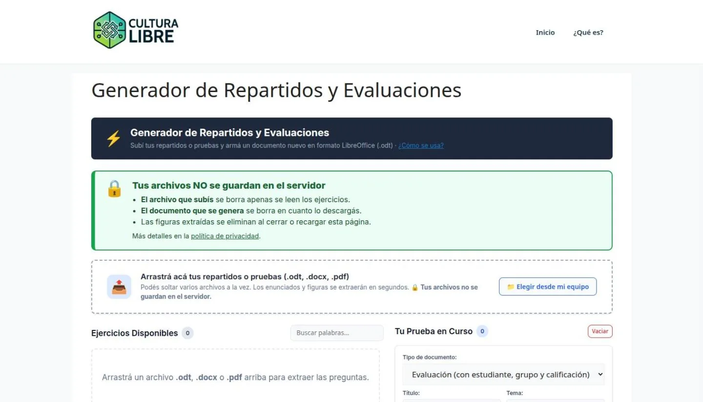
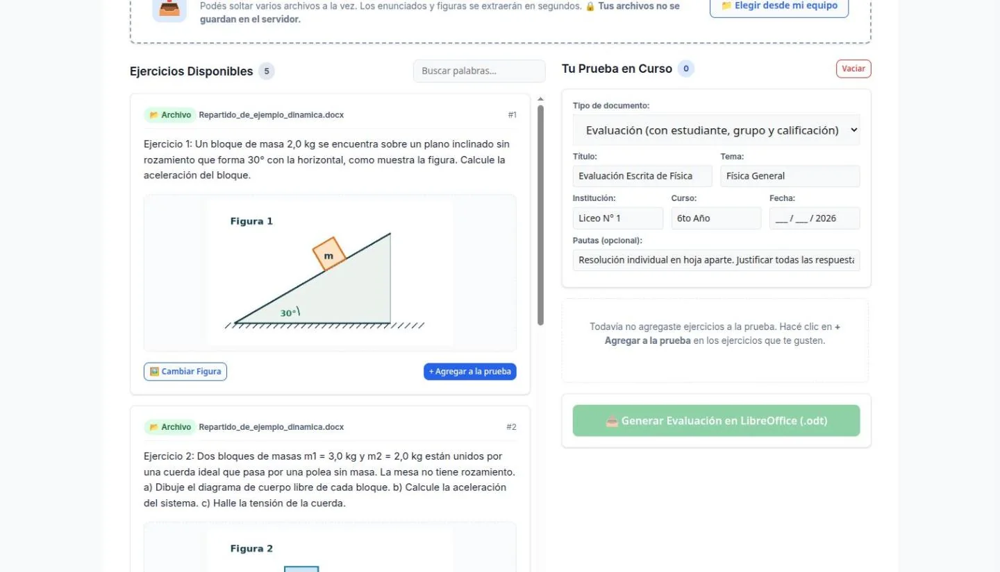

# Generador de Repartidos y Evaluaciones (Worksheet & Test Builder)

🌐 **English** · [Español](README.md)

A WordPress plugin for teachers. Upload your past worksheets and tests (`.odt`, `.docx` or `.pdf`); the plugin **extracts the exercises and their figures**, you pick the ones you want, and it builds a new document in **LibreOffice (`.odt`)** on A4 paper, ready to print or keep editing.

Designed for Physics, but it works for any subject.

> **⚠️ Language note:** the plugin's interface and help pages are currently **in Spanish only**. Translation support through standard WordPress internationalisation (`__()`, `.pot`/`.po` files) is planned. This README is in English so the project is easier to find and evaluate; the Spanish [README.md](README.md) is the reference documentation.

  
  

## What it does

- Reads `.odt`, `.docx` and `.pdf` files and splits them into exercises, with their sub-questions (`a)`, `b)`, …) and figures.
- Figures are matched by their real position in the document (DOCX) or by page (PDF). If one ends up in the wrong place, you can change or link it by hand.
- You build the test by choosing exercises from one or several files. Two document types: **Evaluation** (with student, group and grade fields) or **Handout**.
- Generates the `.odt` with an institutional header and downloads it automatically.

## Privacy

**Your files are not stored on the server.** The uploaded file is deleted as soon as the exercises have been read, the generated document is deleted as soon as it is downloaded, and the figures are removed when you close or reload the page. The typeface is served from the plugin itself: nothing is requested from Google Fonts.

## Try it

- Manual with screenshots (Spanish): <https://culturalibre.uy/generador-evaluaciones/manual/>
- Help (Spanish): <https://culturalibre.uy/generador-evaluaciones/ayuda/>
- Tool: <https://culturalibre.uy/generador-evaluaciones/> (requires login; access is configured by each installation).

## Installation

Requirements: WordPress 5.9 or later, PHP 8 with the `zip`, `dom` and `mbstring` extensions, and `pandoc` on the server (`sudo apt install pandoc`; to read PDF files you also need `poppler-utils`).

1. Copy the plugin folder to `wp-content/plugins/` (or upload a `.zip` from *Plugins → Add New*) and activate it.
2. Create a page with the shortcode `[generador_evaluaciones]` and a child page with `[generador_evaluaciones_ayuda]`.
3. In *Settings → Generador*, choose who can use it: any logged-in user, or only teachers allowed by a list of emails or domains.
4. In nginx, block the working folder with the rules in [`nginx-ejemplo.conf`](nginx-ejemplo.conf).

Settings, filters and the per-version changelog are documented in [`README.txt`](README.txt).

## Development

Automated tests, no WordPress needed: `php tests/run.php`. They run on GitHub on every push.

## License

Free software under **GPL v3 or later**. Full text in [`LICENSE`](LICENSE). Copyright © 2026 Leonardo Trujillo.

## Support the project

If it is useful to you, you can support its maintenance on [GitHub Sponsors](https://github.com/sponsors/kterva). Contributions cover server, domain and development tools. Telling colleagues about it and reporting bugs in the *issues* also helps a lot.
