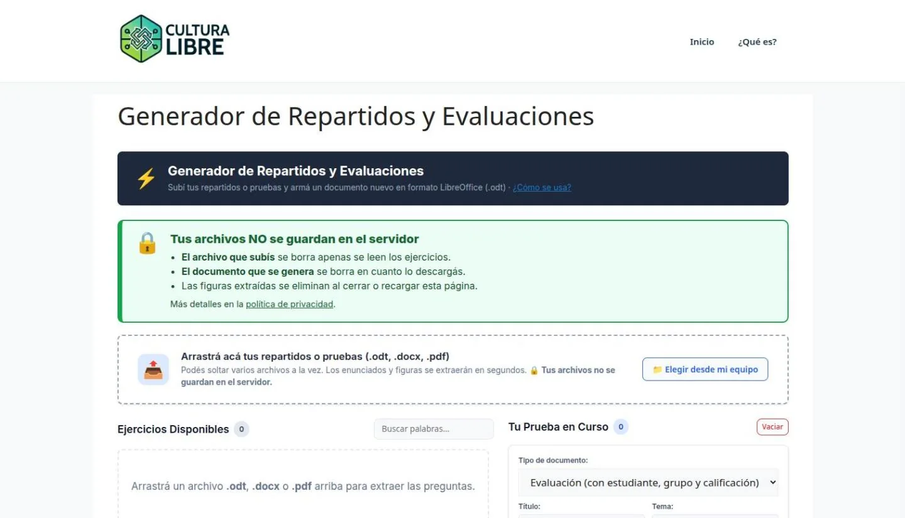
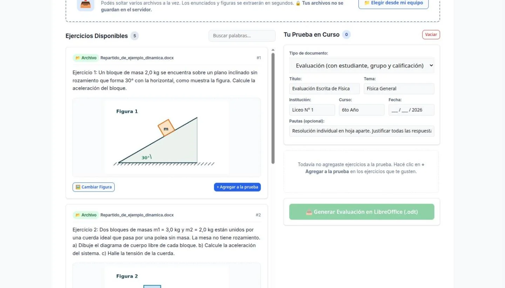

# Generador de Repartidos y Evaluaciones

Plugin de WordPress para docentes: subís tus repartidos y pruebas anteriores (`.odt`, `.docx` o `.pdf`), el plugin **extrae los ejercicios y sus figuras**, elegís cuáles usar y genera un documento nuevo en **LibreOffice (`.odt`)**, en hoja A4, listo para imprimir o seguir editando.

Pensado para Física, pero sirve para cualquier asignatura.

  
  

## Qué hace

- Lee `.odt`, `.docx` y `.pdf` y separa los ejercicios, con sus subpreguntas (`a)`, `b)`…) y sus figuras.
- Las figuras se asignan por su posición real en el documento (DOCX) o por página (PDF); si alguna queda mal, se puede cambiar o vincular a mano.
- Armás la prueba eligiendo ejercicios de uno o varios archivos. Dos tipos de documento: **Evaluación** (con estudiante, grupo y calificación) o **Repartido**.
- Genera el `.odt` con encabezado institucional y se descarga solo.

## Privacidad

**Tus archivos no se guardan en el servidor**: el archivo subido se borra apenas se leen los ejercicios, el documento generado se borra en cuanto se descarga y las figuras se eliminan al cerrar o recargar la página. Además, la tipografía se sirve desde el propio plugin: no se pide nada a Google Fonts.

## Probarlo

- Manual con capturas: <https://culturalibre.uy/generador-evaluaciones/manual/>
- Ayuda: <https://culturalibre.uy/generador-evaluaciones/ayuda/>
- Herramienta: <https://culturalibre.uy/generador-evaluaciones/> (requiere iniciar sesión; el acceso lo configura cada instalación).

## Instalación

Requisitos: WordPress 5.9 o superior, PHP 8 con `zip`, `dom` y `mbstring`, y `pandoc` en el servidor (`sudo apt install pandoc`; para leer PDF, también `poppler-utils`).

1. Copiá la carpeta del plugin a `wp-content/plugins/` (o subí un `.zip` desde *Plugins → Añadir nuevo*) y activalo.
2. Creá una página con el shortcode `[generador_evaluaciones]` y otra, hija, con `[generador_evaluaciones_ayuda]`.
3. En *Ajustes → Generador* elegís quién puede usarlo (cualquier persona con sesión iniciada o solo docentes habilitados por lista de correos o dominios).
4. En nginx, bloqueá la carpeta de trabajo con las reglas de [`nginx-ejemplo.conf`](nginx-ejemplo.conf).

El detalle de ajustes, filtros y cambios por versión está en [`README.txt`](README.txt).

## Desarrollo

Tests automáticos, sin WordPress: `php tests/run.php`. Se ejecutan en GitHub en cada push.

## Licencia

Software libre bajo **GPL v3 o posterior**. Texto completo en [`LICENSE`](LICENSE). Copyright © 2026 Leonardo Trujillo.

## Apoyar el proyecto

Si te sirve, podés apoyar su mantenimiento en [GitHub Sponsors](https://github.com/sponsors/kterva). Los aportes cubren servidor, dominio y herramientas de desarrollo. También ayuda mucho difundirlo entre colegas y avisar de errores en los *issues*.

---

**English:** WordPress plugin for teachers. Upload past worksheets or tests (`.odt`, `.docx`, `.pdf`); it extracts the exercises and figures, lets you pick the ones you want and builds a new A4 LibreOffice (`.odt`) document. Uploaded files are not stored on the server. The interface is in Spanish only. GPL v3 or later.
